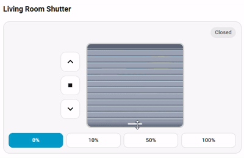

# Modern Shutter Card

[](https://github.com/hacs/integration)
[](https://github.com/sharonoren1/modern-shutter-card/releases)
[](LICENSE)
[](https://www.buymeacoffee.com/orensharon)

A modern, zero-dependency Lovelace **shutter, blinds & sliding curtain card** for **Home Assistant**, built with crisp CSS/SVG graphics, live animated weather & sunrise/day/sunset/night window scenes, group controls, full mobile touch-lock, drag-and-drop editable quick presets, tilt control, open-window safety protection, multi-language & RTL support, Sections View sizing, and a built-in Visual Editor.




If you find this card useful and want to support its ongoing development, feel free to buy me a coffee!

<a href="https://www.buymeacoffee.com/orensharon" target="_blank">
  
</a>

---

## Features

- **All Cover & Curtain Types** — Dedicated CSS/SVG designs and interactions for **Rolling Shutters**, **Double Sliding Curtains**, **Single Sliding Curtains (Left / Right)**, **Roller Shades**, and **Venetian Blinds** — with automatic detection via Home Assistant `device_class`.
- **Live Animated Weather & 4-Phase Sky (Default)** — Layers seamless, GPU-accelerated pure CSS/SVG weather animations (**clear**, **partly cloudy**, **cloudy**, **rainy**, **pouring**, **lightning storm**, **snowy**, **heavy snow**, **fog**, **windy**) over an automatic **Sunrise / Day / Sunset / Night** sky driven by `sun.sun` and your `weather.*` entity — complete with rotating sun rays, gliding birds, twinkling stars, and realistic hazy sun/moon visibility.
- **Scenic Window Backgrounds & Animation Toggle** — Also includes standalone scenes (`auto`, `sky`, `sunny`, `sea`, `sunset`, `mountains`, `night`) plus custom image URL support, and an `animate_background` toggle (with automatic `prefers-reduced-motion` support).
- **Group Controls (`show_group_controls`)** — Cards with 2 or more covers display compact **Open / Stop / Close All** buttons in the header while respecting each entity's `invert_position` and open-window safety lock.
- **Flexible Layout & Controls** — Place Open / Stop / Close buttons on the **Left** or **Right** (`buttons_position`), toggle center window dividers (`show_window_grid`), or mix multiple cover types side by side in **Compact Mode**.
- **Smart Directional Dragging & Touch-Lock** — Vertical drag for shutters/shades and horizontal drag (center-out or side-to-side) for sliding curtains, with mobile touch-lock and haptic feedback.
- **Pure CSS & SVG Graphics** — Crisp at every resolution, zero external images or build dependencies.
- **Multi-Language & Full RTL Support** — Auto-detects Home Assistant's language (or set manually) with built-in translations for **English, Hebrew (עברית), Arabic (العربية), Russian (Русский), French (Français), German (Deutsch), Spanish (Español), Italian (Italiano), and Dutch (Nederlands)** — for both the card and the Visual Editor.
- **Drag-and-Drop Quick Position Presets** — One-tap customizable preset buttons (default `0%`, `15%`, `50%`, `100%`) that can be added, removed, edited, and reordered via drag-and-drop directly inside the Visual Editor.
- **Home Assistant Sections View** — Implements `getGridOptions()` for native drag-to-resize layouts.
- **Built-in Visual Editor** — Configure entities, cover types, colors/fabrics, window backgrounds, weather entity, animation toggle, button side, group controls, dividers, presets, language, and window sensors directly from the UI.
- **Themes, Fabrics & Dark Mode** — Uses official Home Assistant CSS variables plus built-in slat & fabric palettes (`gray`, `white`, `wood`, `black`, `beige`, `navy`, `sage`, `burgundy`, or any valid CSS color).
- **Live Motion Animation** — Smooth transitions and directional movement indicators (vertical or horizontal) during `opening` / `closing`.
- **Invert Position** — Per-card or per-entity inversion for motors where `0%` is open and `100%` is closed (common on Tuya/Zigbee modules).
- **Venetian / Tilt Support** — Automatic tilt slider when the cover entity supports `set_cover_tilt_position`, with live slat opacity feedback on Venetian blinds.
- **Open Window Sensor Protection** — Link a `binary_sensor` to display a live open-window badge and optionally block accidental closing.

---

## Supported Cover Types (`cover_type`)

| Value | Visual Style | Drag & Controls |
| --- | --- | --- |
| `auto` *(default)* | Detects from HA `device_class` (`curtain` → `curtain`, `shade` → `roller`, `blind` → `venetian`, fallback → `shutter`) | Automatic |
| `shutter` | Classic rolling shutter with horizontal slats & bottom bar | Vertical drag, Up / Stop / Down |
| `curtain` | Double sliding curtain with top rod & vertical fabric pleats opening from the center | Horizontal drag (center ↔ edges), Open / Stop / Close |
| `curtain_left` | Single sliding curtain gathering to the left | Horizontal drag (left ↔ right), Open / Stop / Close |
| `curtain_right` | Single sliding curtain gathering to the right | Horizontal drag (right ↔ left), Open / Stop / Close |
| `roller` | Smooth woven roller shade with top cylinder roll & weighted hem bar | Vertical drag, Up / Stop / Down |
| `venetian` | Thin slatted Venetian blinds with ladder cords & live visual tilt shading | Vertical drag + Tilt slider |

---

## Window Backgrounds (`window_background`)

| Value | Description |
| --- | --- |
| `weather` *(default)* | Live animated weather overlay (clear, partly cloudy, cloudy, rainy, pouring, lightning storm, snowy, heavy snow, fog, windy) layered over an automatic 4-phase sky (`sunrise`, `day`, `sunset`, `night`) using `sun.sun` and your `weather.*` entity. |
| `auto` | Automatically transitions through `sunrise`, `day`, `sunset`, and `night` based on Home Assistant's `sun.sun` elevation. |
| `sky` | Clean blue sky gradient (adapts to dark mode). |
| `sunny` | Bright sunny sky with rotating sun rays, soft clouds, and gliding birds. |
| `sea` | Ocean horizon with gentle animated waves and sun reflection. |
| `sunset` | Warm sunset gradient over water with animated sun rays. |
| `mountains` | Layered mountain peaks with sky and greenery. |
| `night` | Starry night sky with twinkling stars and crescent moon. |
| *Custom URL / Path* | Any image path or URL in YAML (e.g. `/local/balcony.jpg`) to display your own view. |

---

## Installation

### Via HACS (Recommended)

Modern Shutter Card is available in the default **HACS** store.

[](https://my.home-assistant.io/redirect/hacs_repository/?owner=sharonoren1&repository=modern-shutter-card&category=plugin)

1. Open **HACS** in Home Assistant.
2. Search for **Modern Shutter Card**.
3. Click **Download**.
4. Reload your browser / Home Assistant app.

### Manual Installation

1. Download `modern-shutter-card.js` from the latest release.
2. Copy it to `/config/www/modern-shutter-card/modern-shutter-card.js`.
3. Go to **Settings → Dashboards → Resources → Add Resource**:
   - URL: `/local/modern-shutter-card/modern-shutter-card.js`
   - Resource type: **JavaScript Module**

---

## Configuration

You can configure the card completely via the **Visual Editor**, or using YAML:

### Basic Example (Rolling Shutter with Live Weather)

```yaml
type: custom:modern-shutter-card
title: Living Room Shutters
cover_type: shutter
slats_color: gray
window_background: weather
animate_background: true
show_window_grid: true
language: auto
entities:
  - entity: cover.living_room_shutter
    name: Balcony Shutter
```

### Sliding Curtain Example

```yaml
type: custom:modern-shutter-card
title: Master Bedroom
cover_type: curtain
slats_color: beige
window_background: sea
buttons_position: right
show_window_grid: false
entities:
  - entity: cover.bedroom_curtain
    name: Main Curtain
```

### Full-Featured Mixed Example (Shutter + Sliding Curtain + Roller Shade)

```yaml
type: custom:modern-shutter-card
title: Home Covers
compact: true
language: en
window_background: weather
weather_entity: weather.forecast_home
animate_background: true
buttons_position: left
show_group_controls: true
show_window_grid: true
show_presets: true
show_buttons: true
show_percentage: true
show_tilt: auto
haptic: true
rtl: auto
presets:
  - label: Closed
    position: 0
  - label: Vent
    position: 10
  - label: Half
    position: 50
  - label: Open
    position: 100
entities:
  - entity: cover.living_room_main
    name: Living Room Shutter
    cover_type: shutter
    slats_color: gray
    window_background: weather
    window_sensor: binary_sensor.living_room_door
    block_close_if_open: true
  - entity: cover.living_room_curtain
    name: Sheer Curtain
    cover_type: curtain
    slats_color: beige
    window_background: sunset
  - entity: cover.office_blind
    name: Office Roller
    cover_type: roller
    slats_color: navy
    window_background: /local/office_view.jpg
    invert_position: true
```

---

## Options Reference

### Card Options

| Option | Type | Default | Description |
| --- | --- | --- | --- |
| `entities` | `list` | **Required** | List of cover entity IDs or entity config objects (or use single `entity`). |
| `title` | `string` | `""` | Optional card header title. |
| `cover_type` | `string` | `auto` | Cover style: `auto`, `shutter`, `curtain`, `curtain_left`, `curtain_right`, `roller`, `venetian`. |
| `language` | `string` | `auto` | UI language: `auto`, `en`, `he`, `ar`, `ru`, `fr`, `de`, `es`, `it`, `nl`. |
| `compact` | `boolean` | `false` | Display multiple covers side by side in a responsive grid. |
| `slats_color` | `string` | `gray` | Color/fabric theme: `gray`, `white`, `wood`, `black`, `beige`, `navy`, `sage`, `burgundy`, or any valid CSS color (`#3b4252`). |
| `window_background` | `string` | `weather` | Window scene: `weather`, `auto`, `sky`, `sunny`, `sea`, `sunset`, `mountains`, `night`, or a custom image path/URL. |
| `weather_entity` | `string` | Auto-detected | Specific `weather.*` entity to use when `window_background: weather` (defaults to the first available `weather.*` entity). |
| `animate_background` | `boolean` | `true` | Enable or disable window background animations (also respects `prefers-reduced-motion`). |
| `buttons_position` | `string` | `left` | Side for the Open / Stop / Close control buttons: `left` or `right`. |
| `show_group_controls` | `boolean` | `true` | Show Open / Stop / Close All buttons in the card header when 2 or more covers are configured. |
| `show_window_grid` | `boolean` | `true` | Show or hide the center window divider crossbars. |
| `show_presets` | `boolean` | `true` | Show quick-position preset buttons. |
| `presets` | `list` | `0/15/50/100%` | Custom list of `{ label, position }` objects (editable and reorderable from the Visual Editor). |
| `show_buttons` | `boolean` | `true` | Show Open / Stop / Close control buttons. |
| `show_percentage` | `boolean` | `true` | Show open percentage badge on the cover. |
| `show_tilt` | `auto \| boolean` | `auto` | Show tilt slider (`auto` detects entity capability). |
| `invert_position` | `boolean` | `false` | Invert position logic (`0%` = open, `100%` = closed). |
| `haptic` | `boolean` | `true` | Trigger subtle haptic feedback on drag/tap. |
| `rtl` | `auto \| boolean` | `auto` | Force RTL or auto-detect from language / Home Assistant direction. |

### Per-Entity Options

| Option | Type | Default | Description |
| --- | --- | --- | --- |
| `entity` | `string` | **Required** | Cover entity ID (e.g. `cover.bedroom_curtain`). |
| `name` | `string` | Friendly name | Custom display name. |
| `cover_type` | `string` | Card default | Override cover type for this specific entity (`shutter`, `curtain`, `curtain_left`, `curtain_right`, `roller`, `venetian`). |
| `slats_color` | `string` | Card default | Override color/fabric theme for this specific entity. |
| `window_background` | `string` | Card default | Override window background scene or custom image URL for this specific entity. |
| `weather_entity` | `string` | Card default | Override `weather.*` entity for this specific cover. |
| `invert_position` | `boolean` | Card default | Override inversion for this specific cover. |
| `window_sensor` | `string` | `""` | Optional `binary_sensor` to display an open-window warning badge. |
| `block_close_if_open` | `boolean` | `false` | Prevent closing the cover while `window_sensor` is open. |

---

## Support

If you find this card useful and want to support its ongoing development, feel free to buy me a coffee!

<a href="https://www.buymeacoffee.com/orensharon" target="_blank">
  
</a>

---

## License

MIT License © 2026 [Oren Sharon](https://github.com/sharonoren1)
