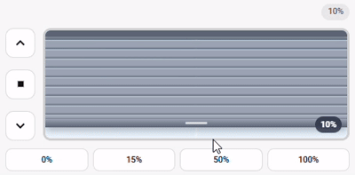
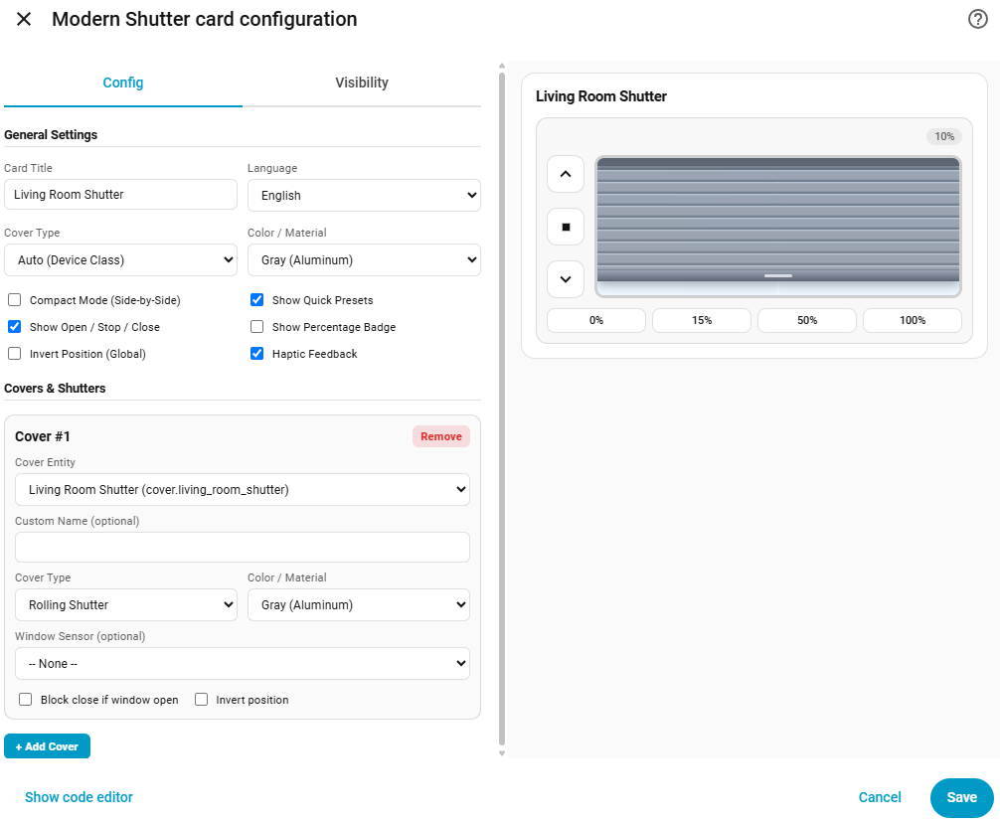

# Modern Shutter Card

[](https://github.com/hacs/integration)
[](https://github.com/sharonoren1/modern-shutter-card/releases)
[](LICENSE)

A modern, zero-dependency Lovelace shutter & blinds card for **Home Assistant**, built with crisp CSS/SVG graphics, full mobile touch-lock, quick presets, tilt control, open-window safety protection, multi-language & RTL support, Sections View sizing, and a built-in Visual Editor.





---

## Features

- **Pure CSS & SVG Graphics** — Crisp at every resolution, zero external images or build dependencies.
- **Multi-Language & Full RTL Support** — Auto-detects Home Assistant's language (or set manually) with built-in translations for **English, Hebrew (עברית), Arabic (العربية), Russian (Русский), French (Français), German (Deutsch), Spanish (Español), Italian (Italiano), and Dutch (Nederlands)** — for both the card and the Visual Editor.
- **Mobile Touch-Lock & Haptic Feedback** — Smooth vertical dragging on touchscreens without scrolling the dashboard.
- **Quick Position Presets** — One-tap customizable preset buttons (e.g. `0%`, `15%`, `50%`, `100%`).
- **Home Assistant Sections View** — Implements `getGridOptions()` for native drag-to-resize layouts.
- **Built-in Visual Editor** — Configure entities, language, colors, presets, and window sensors directly from the UI.
- **Themes & Dark Mode** — Uses official Home Assistant CSS variables plus slat color themes (`gray`, `white`, `wood`, `black`, or custom hex).
- **Live Motion Animation** — Smooth transitions and directional movement indicators during `opening` / `closing`.
- **Invert Position** — Per-card or per-entity inversion for motors where `0%` is open and `100%` is closed (common on Tuya/Zigbee modules).
- **Venetian / Tilt Support** — Automatic tilt slider when the cover entity supports `set_cover_tilt_position`.
- **Open Window Sensor Protection** — Link a `binary_sensor` to display a live open-window badge and optionally block accidental closing.
- **Compact Multi-Shutter Mode** — Display 2–3 shutters side by side in a single responsive card.

---

## Installation

### Via HACS (Recommended)

1. Open **HACS** in Home Assistant.
2. Click the three-dot menu in the top right and select **Custom repositories**.
3. Add repository URL:
   ```text
   https://github.com/sharonoren1/modern-shutter-card
   ```
4. Select category **Dashboard** (or **Lovelace**) and click **Add**.
5. Search for **Modern Shutter Card** and click **Download**.
6. Reload your browser / Home Assistant app.

### Manual Installation

1. Download `modern-shutter-card.js` from the latest release.
2. Copy it to `/config/www/modern-shutter-card/modern-shutter-card.js`.
3. Go to **Settings → Dashboards → Resources → Add Resource**:
   - URL: `/local/modern-shutter-card/modern-shutter-card.js`
   - Resource type: **JavaScript Module**

---

## Configuration

You can configure the card completely via the **Visual Editor**, or using YAML:

### Basic Example

```yaml
type: custom:modern-shutter-card
title: תריסי סלון
slats_color: gray
language: auto
entities:
  - entity: cover.living_room_shutter
    name: תריס מרפסת
```

### Full-Featured Example (Compact Mode + Window Sensor + Custom Presets)

```yaml
type: custom:modern-shutter-card
title: תריסי הבית
compact: true
language: he
slats_color: wood
show_presets: true
show_buttons: true
show_percentage: true
show_tilt: auto
haptic: true
rtl: auto
presets:
  - label: סגור
    position: 0
  - label: חריצים
    position: 15
  - label: חצי
    position: 50
  - label: פתוח
    position: 100
entities:
  - entity: cover.living_room_main
    name: סלון ראשי
    window_sensor: binary_sensor.living_room_door
    block_close_if_open: true
  - entity: cover.kitchen_shutter
    name: מטבח
    invert_position: true
    slats_color: white
```

---

## Options Reference

### Card Options

| Option | Type | Default | Description |
| --- | --- | --- | --- |
| `entities` | `list` | **Required** | List of cover entity IDs or entity config objects (or use single `entity`). |
| `title` | `string` | `""` | Optional card header title. |
| `language` | `string` | `auto` | UI language: `auto`, `en`, `he`, `ar`, `ru`, `fr`, `de`, `es`, `it`, `nl`. |
| `compact` | `boolean` | `false` | Display multiple shutters side by side in a responsive grid. |
| `slats_color` | `string` | `gray` | Slat theme: `gray`, `white`, `wood`, `black`, or any CSS color (`#3b4252`). |
| `show_presets` | `boolean` | `true` | Show quick-position preset buttons. |
| `presets` | `list` | `0/15/50/100%` | Custom list of `{ label, position }` objects. |
| `show_buttons` | `boolean` | `true` | Show Up / Stop / Down control buttons. |
| `show_percentage` | `boolean` | `true` | Show open percentage badge on the shutter. |
| `show_tilt` | `auto \| boolean` | `auto` | Show tilt slider (`auto` detects entity capability). |
| `invert_position` | `boolean` | `false` | Invert position logic (`0%` = open, `100%` = closed). |
| `haptic` | `boolean` | `true` | Trigger subtle haptic feedback on drag/tap. |
| `rtl` | `auto \| boolean` | `auto` | Force RTL or auto-detect from language / Home Assistant direction. |

### Per-Entity Options

| Option | Type | Default | Description |
| --- | --- | --- | --- |
| `entity` | `string` | **Required** | Cover entity ID (e.g. `cover.bedroom_shutter`). |
| `name` | `string` | Friendly name | Custom display name. |
| `invert_position` | `boolean` | Card default | Override inversion for this specific shutter. |
| `slats_color` | `string` | Card default | Override slat color for this specific shutter. |
| `window_sensor` | `string` | `""` | Optional `binary_sensor` to display an open-window warning badge. |
| `block_close_if_open` | `boolean` | `false` | Prevent closing the shutter while `window_sensor` is open. |

---

## License

MIT License © 2026 [Oren Sharon](https://github.com/sharonoren1)
